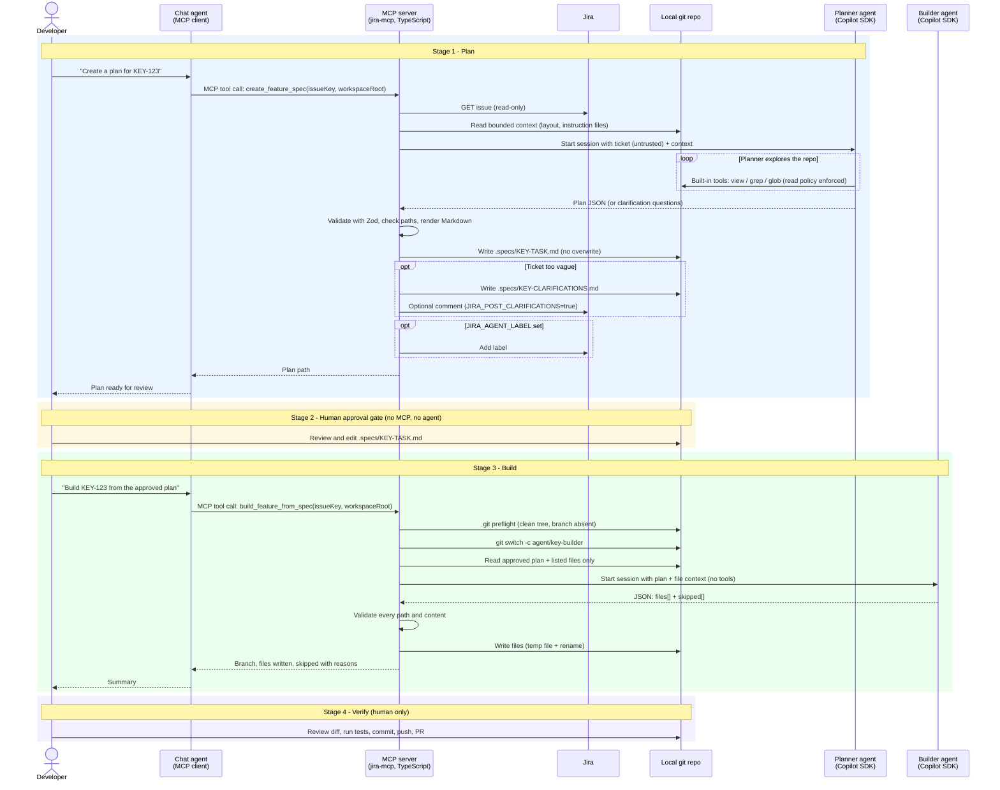
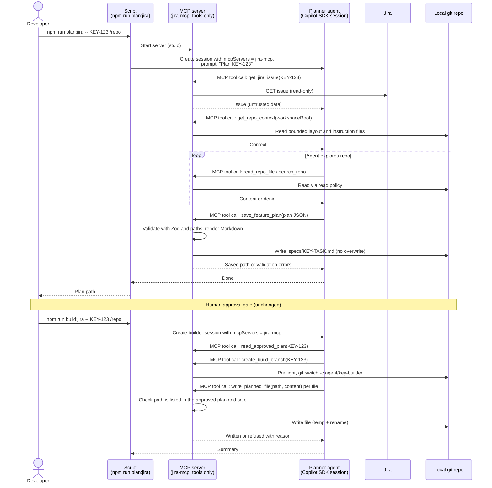

# Spec-First Feature Workflow: Detailed Flow (who calls what)

Companion to the high-level flow in [feature-workflow.md](./feature-workflow.md). This view shows, for every step, **which actor acts**, **when the MCP server is involved**, and **which tool or built-in is called**.

## Legend

| Actor         | What it is                                                                                               |
| ------------- | -------------------------------------------------------------------------------------------------------- |
| Developer     | Human in VS Code                                                                                         |
| Chat agent    | VS Code Copilot chat (MCP client). Only calls the two MCP tools when the developer asks                  |
| `plan:jira` script | `npm run plan:jira -- <KEY> <repo>` runs `src/example-plan-jira.ts`. Calls the planner service in-process, not over MCP |
| MCP server    | TypeScript server `jira-mcp`. Runs deterministic code, hosts the tools, orchestrates agents            |
| Planner agent | Copilot SDK session started by `create_feature_spec`. Built-in tools `view`, `grep`, `glob` only |
| Builder agent | Copilot SDK session started by `build_feature_from_spec`. No tools, JSON in / JSON out                 |
| Jira / Repo   | Jira REST API (read-only, optional comment/label) and the local git repository                           |

Planner and builder agents never call MCP tools themselves. The MCP server calls them.

## Orchestration pattern: code-orchestrated, not agent-orchestrated

A common mental model is: a script starts the MCP server, starts a first agent, and that agent calls tools such as `get_jira_issue` on the server. **This workflow does not work that way.**

|                                     | Agent-driven (not used here)             | Server-orchestrated (used here)                                      |
| ----------------------------------- | ---------------------------------------- | -------------------------------------------------------------------- |
| Entry point                         | Script launches server, then an agent    | Either the chat agent making one MCP tool call, or `npm run plan:jira` calling the same service function in-process (no MCP) |
| Who fetches Jira data               | The agent, by calling `get_jira_issue` | The MCP server's TypeScript code, directly                           |
| Who decides the next step           | The agent (LLM)                          | Deterministic TypeScript in the tool handler                         |
| Copilot SDK agents                  | Call MCP tools                           | Are started by the server, are given prepared input, and return JSON |
| MCP tools available to those agents | Yes                                      | None                                                                 |

Why: the Jira ticket is untrusted text. Keeping Jira access, git, file writes and validation in code means the LLM can only produce a proposal (plan JSON or file contents). The server validates that proposal before anything is saved or written. The planner's only reach is read-only `view`/`grep`/`glob` on the repo. The builder has no tools.

`get_jira_issue` and `search_jira` still exist as standalone MCP tools for the chat agent to use directly. They are not used inside `create_feature_spec` or `build_feature_from_spec`.

## Entry points for the plan stage

`create_feature_spec` and `npm run plan:jira` share the same service, `createFeatureSpecService` in `src/tools/createFeatureSpec.ts`. Only the way it is invoked differs.

| Entry point | Command | Path to the planner |
| --- | --- | --- |
| Chat agent (MCP) | Developer asks in VS Code chat | Chat agent -> MCP `create_feature_spec` -> service -> planner agent |
| Script | `npm run plan:jira -- <ISSUE-KEY> <absolute-repo-path>` | `src/example-plan-jira.ts` -> service -> planner agent. The MCP server is not started and no MCP call is made |

The diagram below shows the chat-agent path. For the script path, replace "Chat agent" and the MCP tool call with the script calling the service directly; everything from "GET issue" onward is identical.

## Detailed flow

## Step table

| #  | Stage  | Who acts      | Calls                             | Via                   | MCP server involved?       |
| -- | ------ | ------------- | --------------------------------- | --------------------- | -------------------------- |
| 1  | Plan   | Chat agent    | `create_feature_spec`           | MCP tool call         | Yes, entry point           |
| 2  | Plan   | MCP server    | Jira issue fetch                  | Jira REST (read-only) | Yes                        |
| 3  | Plan   | MCP server    | Repo layout and instruction files | Local file reads      | Yes                        |
| 4  | Plan   | MCP server    | Planner agent                     | Copilot SDK session   | Yes, starts agent          |
| 5  | Plan   | Planner agent | `view`, `grep`, `glob`      | SDK built-in tools    | No (agent's own tools)     |
| 6  | Plan   | MCP server    | Validate, render, save plan       | Local code            | Yes                        |
| 7  | Plan   | MCP server    | Jira comment / label (optional)   | Jira REST             | Yes, only if env flags set |
| 8  | Gate   | Developer     | Edit plan                         | Editor                | No                         |
| 9  | Build  | Chat agent    | `build_feature_from_spec`       | MCP tool call         | Yes, entry point           |
| 10 | Build  | MCP server    | git preflight, create branch      | git                   | Yes                        |
| 11 | Build  | MCP server    | Builder agent                     | Copilot SDK session   | Yes, starts agent          |
| 12 | Build  | Builder agent | Nothing (returns JSON)            | n/a                   | No                         |
| 13 | Build  | MCP server    | Validate and write files          | Local code            | Yes                        |
| 14 | Verify | Developer     | Diff, tests, commit, push         | git / IDE             | No                         |

Other MCP tools (`search_jira`, `get_jira_issue`, `audit_jira_duplicates`, `fetch_triage_backlog`, `fetch_candidate_descriptions`) are separate and are not part of this workflow.

---

# Proposed: agent-driven pattern (new branch)

Goal: make the MCP server a modular toolbox that any script or agent can use, instead of a black box that runs its own agents. The Copilot SDK supports this: `createSession` accepts `mcpServers`, so an agent session can be given the server's tools and call them itself.

## Proposed flow

## Proposed tool split

| Tool | Status | Responsibility | Guardrails that must live in the tool |
| --- | --- | --- | --- |
| `get_jira_issue` | Exists | Fetch one issue | Read-only |
| `get_repo_context` | New (from `repoContext.ts`) | Bounded layout and instruction files | Size limits |
| `read_repo_file`, `search_repo` | New (optional, replaces SDK `view`/`grep`/`glob`) | Repo exploration | `readPolicy.ts` and `ReadBudget` |
| `save_feature_plan` | New (from `featureSpec.ts`) | Validate and save plan | Zod schema, path checks, no overwrite |
| `read_approved_plan` | New | Return the approved plan | Only `.specs/KEY-TASK.md` |
| `create_build_branch` | New | Git preflight and branch | Clean tree, branch absent |
| `write_planned_file` | New (from `featureBuilder.ts`) | Write one file | Path must be in the approved plan, safe path, atomic write |
| `create_feature_spec`, `build_feature_from_spec` | Existing | Keep as convenience wrappers | Unchanged |

## Trade-offs to raise with the lead

- **Security moves into the tools.** Today the orchestrating code sits between the LLM and every side effect. In the agent-driven pattern the agent holds Jira ticket text (untrusted) and write-capable tools in one session, so prompt injection in a ticket could try to steer tool calls. Every tool must enforce its own limits, and `write_planned_file` must check against the approved plan rather than trust the agent.
- **Less deterministic.** The agent chooses call order, so runs vary. Tool errors must be clear enough for the agent to recover.
- **Permission prompts.** The session must approve MCP tool calls explicitly (an allow-list of `jira-mcp` tools only; deny shell and other writes).
- **Timeouts, single-flight and metrics** currently live in the tool handlers and runner. They need to move to the script (overall timeout) and the per-tool handlers.
- **Reuse.** Other scripts and agents can mix these tools freely, which is the main benefit.
