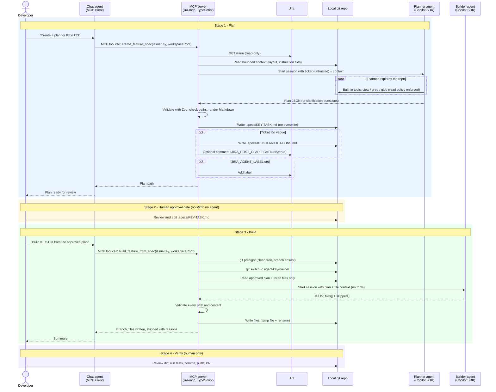
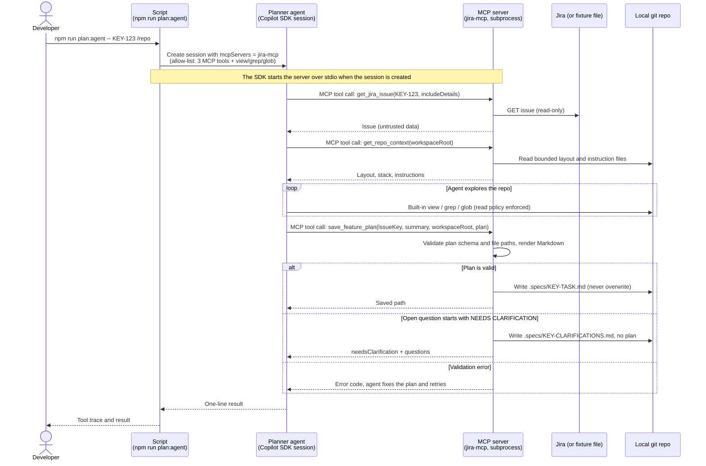
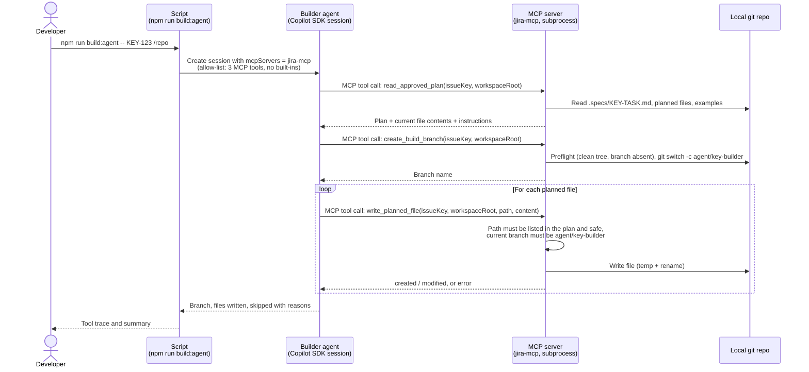
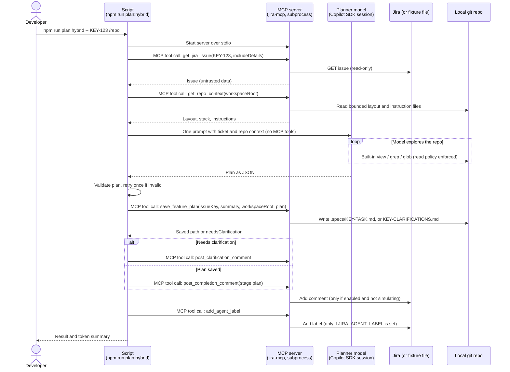
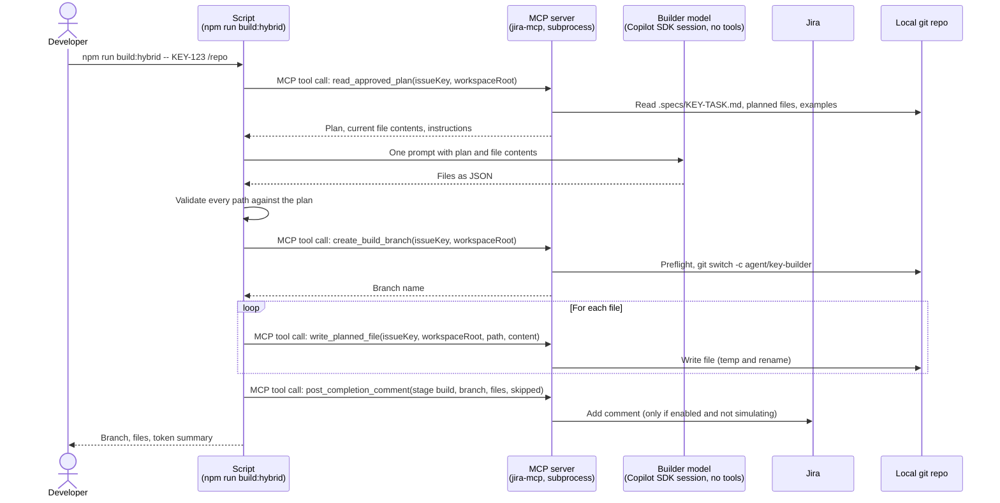

# Spec-First Feature Workflow: Detailed Flow (who calls what)

Companion to the high-level flow in [feature-workflow.md](./feature-workflow.md). This view shows, for every step, **which actor acts**, **when the MCP server is involved**, and **which tool or built-in is called**.

## Legend

| Actor                | What it is                                                                                                                  |
| -------------------- | --------------------------------------------------------------------------------------------------------------------------- |
| Developer            | Human in VS Code                                                                                                            |
| Chat agent           | VS Code Copilot chat (MCP client). Only calls the two MCP tools when the developer asks                                     |
| `plan:jira` script | `npm run plan:jira -- <KEY> <repo>` runs `src/example-plan-jira.ts`. Calls the planner service in-process, not over MCP |
| MCP server           | TypeScript server `jira-mcp`. Runs deterministic code, hosts the tools, orchestrates agents                               |
| Planner agent        | Copilot SDK session started by `create_feature_spec`. Built-in tools `view`, `grep`, `glob` only                    |
| Builder agent        | Copilot SDK session started by `build_feature_from_spec`. No tools, JSON in / JSON out                                    |
| Jira / Repo          | Jira REST API (read-only, optional comment/label) and the local git repository                                              |

In the server-orchestrated pattern, planner and builder agents never call MCP tools themselves; the MCP server calls them. In the agent-driven pattern the agents call the MCP tools directly.

## Orchestration patterns: server-orchestrated and agent-driven

A common mental model is: a script starts the MCP server, starts a first agent, and that agent calls tools such as `get_jira_issue` on the server. **The workflow supports both that agent-driven pattern and the original server-orchestrated one.** The tables and the first diagram below describe the original, server-orchestrated pattern (`create_feature_spec`, `build_feature_from_spec`). The agent-driven pattern is described in [Agent-driven pattern (implemented)](#agent-driven-pattern-implemented).

|                                     | Agent-driven (not used here)             | Server-orchestrated (used here)                                                                                                |
| ----------------------------------- | ---------------------------------------- | ------------------------------------------------------------------------------------------------------------------------------ |
| Entry point                         | Script launches server, then an agent    | Either the chat agent making one MCP tool call, or `npm run plan:jira` calling the same service function in-process (no MCP) |
| Who fetches Jira data               | The agent, by calling `get_jira_issue` | The MCP server's TypeScript code, directly                                                                                     |
| Who decides the next step           | The agent (LLM)                          | Deterministic TypeScript in the tool handler                                                                                   |
| Copilot SDK agents                  | Call MCP tools                           | Are started by the server, are given prepared input, and return JSON                                                           |
| MCP tools available to those agents | Yes                                      | None                                                                                                                           |

Why: the Jira ticket is untrusted text. Keeping Jira access, git, file writes and validation in code means the LLM can only produce a proposal (plan JSON or file contents). The server validates that proposal before anything is saved or written. The planner's only reach is read-only `view`/`grep`/`glob` on the repo. The builder has no tools.

`get_jira_issue` and `search_jira` are standalone MCP tools. `create_feature_spec` and `build_feature_from_spec` do not call them; the agent-driven planner does call `get_jira_issue`.

## Entry points for the plan stage

`create_feature_spec` and `npm run plan:jira` share the same service, `createFeatureSpecService` in `src/tools/createFeatureSpec.ts`. Only the way it is invoked differs.

| Entry point      | Command                                                   | Path to the planner                                                                                             |
| ---------------- | --------------------------------------------------------- | --------------------------------------------------------------------------------------------------------------- |
| Chat agent (MCP) | Developer asks in VS Code chat                            | Chat agent -> MCP `create_feature_spec` -> service -> planner agent                                           |
| Script           | `npm run plan:jira -- <ISSUE-KEY> <absolute-repo-path>` | `src/example-plan-jira.ts` -> service -> planner agent. The MCP server is not started and no MCP call is made |

The diagram below shows the chat-agent path. For the script path, replace "Chat agent" and the MCP tool call with the script calling the service directly; everything from "GET issue" onward is identical.

## Detailed flow (server-orchestrated)

## Step table

| #  | Stage  | Who acts      | Calls                             | Via                   | MCP server involved?       |
| -- | ------ | ------------- | --------------------------------- | --------------------- | -------------------------- |
| 1  | Plan   | Chat agent    | `create_feature_spec`           | MCP tool call         | Yes, entry point           |
| 2  | Plan   | MCP server    | Jira issue fetch                  | Jira REST (read-only) | Yes                        |
| 3  | Plan   | MCP server    | Repo layout and instruction files | Local file reads      | Yes                        |
| 4  | Plan   | MCP server    | Planner agent                     | Copilot SDK session   | Yes, starts agent          |
| 5  | Plan   | Planner agent | `view`, `grep`, `glob`      | SDK built-in tools    | No (agent's own tools)     |
| 6  | Plan   | MCP server    | Validate, render, save plan       | Local code            | Yes                        |
| 7  | Plan   | MCP server    | Jira comment / label (optional)   | Jira REST             | Yes, only if env flags set |
| 8  | Gate   | Developer     | Edit plan                         | Editor                | No                         |
| 9  | Build  | Chat agent    | `build_feature_from_spec`       | MCP tool call         | Yes, entry point           |
| 10 | Build  | MCP server    | git preflight, create branch      | git                   | Yes                        |
| 11 | Build  | MCP server    | Builder agent                     | Copilot SDK session   | Yes, starts agent          |
| 12 | Build  | Builder agent | Nothing (returns JSON)            | n/a                   | No                         |
| 13 | Build  | MCP server    | Validate and write files          | Local code            | Yes                        |
| 14 | Verify | Developer     | Diff, tests, commit, push         | git / IDE             | No                         |

Other MCP tools (`search_jira`, `get_jira_issue`, `audit_jira_duplicates`, `fetch_triage_backlog`, `fetch_candidate_descriptions`) are separate and are not part of this workflow.

---

# Agent-driven pattern (implemented)

The MCP server also exposes the workflow as small, composable tools. A script starts the server as a subprocess and gives a Copilot SDK agent session access to those tools through `mcpServers`. The agent itself decides when to call each tool. This makes the server a toolbox that any script or agent can reuse, instead of a black box that runs its own agents.

| Script                         | Command                                                           | Agent's MCP tools                                                       |
| ------------------------------ | ----------------------------------------------------------------- | ----------------------------------------------------------------------- |
| `src/example-plan-agent.ts`  | `npm run plan:agent -- <KEY> <absolute-repo-path> [--simulate]` | `get_jira_issue`, `get_repo_context`, `save_feature_plan`         |
| `src/example-build-agent.ts` | `npm run build:agent -- <KEY> <absolute-repo-path>`             | `read_approved_plan`, `create_build_branch`, `write_planned_file` |

The planner agent also keeps the SDK built-ins `view`, `grep` and `glob` (read policy and read budget enforced) for repo exploration. The builder agent has no built-in tools.

## Plan flow

## Human approval gate

Unchanged: the developer reviews and edits `.specs/KEY-TASK.md`. No agent or MCP call is involved.

## Build flow

## Tool reference

| Tool                    | Used by | Responsibility                                                        | Guardrails enforced inside the tool                                                                  |
| ----------------------- | ------- | --------------------------------------------------------------------- | ---------------------------------------------------------------------------------------------------- |
| `get_jira_issue`      | Planner | Fetch one issue (`includeDetails` adds description and comments)    | Read-only; with `JIRA_FIXTURES_DIR` set, reads local fixture files instead of Jira                 |
| `get_repo_context`    | Planner | Bounded layout, stack and instruction files                           | Size limits, read-only                                                                               |
| `save_feature_plan`   | Planner | Validate, render and save the plan, or save clarifications            | Zod plan schema, safe relative paths, no overwrite, writes only under `.specs/`                    |
| `read_approved_plan`  | Builder | Return the approved plan, current contents of planned files, examples | Read-only; plan must be a valid saved plan; size limits                                              |
| `create_build_branch` | Builder | Create `agent/{key}-builder`                                        | Clean tree (except the plan), branch must not exist, never pushes                                    |
| `write_planned_file`  | Builder | Write one planned file                                                | Path must be listed in the approved plan, safe path rules, must be on the build branch, atomic write |

Both scripts allow only these MCP tools in `onPermissionRequest`, and the SDK names them with the server prefix (for example `jira-mcp-write_planned_file`), so the allow-list accepts both forms.

## Both patterns side by side

|                                            | Server-orchestrated (original)                                                   | Model-led (`*:agent`)                              | Hybrid (`*:hybrid`)                                  |
| ------------------------------------------ | -------------------------------------------------------------------------------- | -------------------------------------------------- | ---------------------------------------------------- |
| Plan entry points                          | MCP `create_feature_spec`, `npm run plan:jira`, `npm run simulate -- plan` | `npm run plan:agent`                             | `npm run plan:hybrid`                              |
| Build entry points                         | MCP `build_feature_from_spec`, `npm run simulate -- build`                   | `npm run build:agent`                            | `npm run build:hybrid`                             |
| Who calls `get_jira_issue`               | Nobody; server code reads Jira directly                                          | The planner agent (model decides)                  | The script, in code, over MCP                        |
| Who decides call order                     | TypeScript in the tool handler                                                   | The model, guided by its prompt                    | The script                                           |
| Model sees MCP tools                       | No                                                                               | Yes                                                | No (planner keeps read-only view/grep/glob)          |
| Model output                               | JSON the server validates                                                        | Tool calls the server validates one at a time      | JSON the script validates, then saves via tools      |
| Single-flight guard, timeouts, run metrics | In the tool handlers                                                             | Overall timeout in the script only                 | Overall timeout in the script only                   |
| Jira clarification comment, completion comment, label | Supported (env flags)                                                 | Not supported                                      | Supported through MCP tools (env flags)              |
| Token usage printed                        | Run metrics (`METRICS_FILE`)                                                     | `[tokens]` line                                    | `[tokens]` line                                      |

The original tools `create_feature_spec` and `build_feature_from_spec` are unchanged and still available.

---

# Hybrid pattern (implemented)

A script is the MCP client and runs the fixed steps in code. It calls the server's tools for Jira and repository I/O, uses the model only for reasoning, and calls the server again to save results. The model never sees MCP tools, so the call order is deterministic and the ticket and repo data go into the prompt once instead of through repeated tool round trips. The script connects with `connectJiraMcp` in `src/mcpScriptSupport.ts`.

| Script                         | Command                                                           | MCP tools the script calls                                                                                                          |
| ------------------------------ | ----------------------------------------------------------------- | ----------------------------------------------------------------------------------------------------------------------------------- |
| `src/example-plan-hybrid.ts`  | `npm run plan:hybrid -- <KEY> <absolute-repo-path> [--simulate]` | `get_jira_issue`, `get_repo_context`, `save_feature_plan`, then `post_clarification_comment` or `post_completion_comment`, and `add_agent_label` |
| `src/example-build-hybrid.ts` | `npm run build:hybrid -- <KEY> <absolute-repo-path>`            | `read_approved_plan`, `create_build_branch`, `write_planned_file` per file, `post_completion_comment`                            |

## Hybrid plan flow

## Hybrid build flow

## Jira write tools

All three are off unless enabled, never contact Jira when `JIRA_FIXTURES_DIR` is set, and return a generic error with no details on failure. They return `{posted: false, reason}` when skipped.

| Tool                         | Enabled by                                 | Responsibility                                                               |
| ---------------------------- | ------------------------------------------ | ---------------------------------------------------------------------------- |
| `post_clarification_comment` | `JIRA_POST_CLARIFICATIONS=true`            | Post the clarification questions as one comment                              |
| `post_completion_comment`    | `JIRA_POST_COMPLETION=true`                | Post a plan or build summary (`stage`; build adds branch, files, skipped)    |
| `add_agent_label`            | `JIRA_AGENT_LABEL` set to a valid label    | Add the label to the ticket                                                  |

The hybrid scripts pass these three variables from their own environment to the server subprocess.

## Measured token comparison (SIM-101, one run each)

Same fixture ticket, same repo (`mock-manager-ui`) and same model (`claude-sonnet-5.5`). Single runs, so indicative rather than a benchmark. The plan and build content also differed between runs.

| Stage | Path       | Model calls | Input tokens | Output tokens |
| ----- | ---------- | ----------- | ------------ | ------------- |
| Plan  | Hybrid     | 3           | 10,690       | 1,325         |
| Plan  | Model-led  | 5           | 81,854       | 1,836         |
| Build | Hybrid     | 1           | 4,403        | 1,714         |
| Build | Model-led  | 4           | 76,610       | 2,641         |

Hybrid used about 87% fewer input tokens when planning and about 94% fewer when building. In the model-led path every tool call resends the growing conversation, while the hybrid path fetches data in code and sends it once.

## Testing without Jira

`npm run plan:agent -- SIM-101 /path/to/repo --simulate` sets `JIRA_FIXTURES_DIR` for the server subprocess, so `get_jira_issue` reads `simulation/fixtures/SIM-101.txt` and Jira is never contacted. The first line of a fixture is the summary and the rest is the description.

## Trade-offs to raise with the lead

- **Security moves into the tools.** The agent holds ticket text (untrusted) and write-capable tools in one session, so a prompt-injected ticket could try to steer tool calls. Today each tool enforces its own limits (plan-listed paths only, branch check, no overwrite, read policy). Stronger controls such as injection detection and per-run approval are deferred until beyond the demo.
- **Less deterministic.** The agent chooses the call order, so runs vary. Tool errors are written so the agent can recover.
- **Prompt-dependent.** Correct order relies on the agent prompts in the two scripts.
- **Not yet ported to either script pattern:** run metrics (`METRICS_FILE`) and the single-flight guard. The hybrid path covers the Jira comment and label through the new tools.
- **Hybrid trade-off.** The hybrid path is more deterministic and cheaper (see the token table), but the script, not the agent, owns the workflow. Agents that want to drive the tools themselves still can, as in the model-led pattern.
- **Reuse.** Other scripts and agents can mix these tools freely, which is the main benefit.
