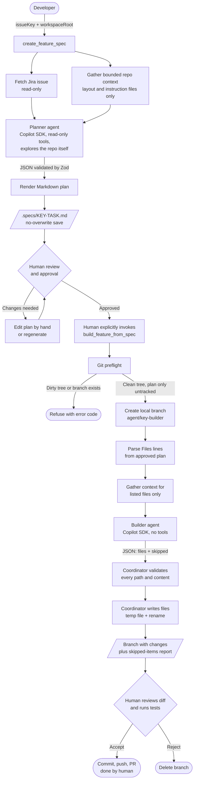
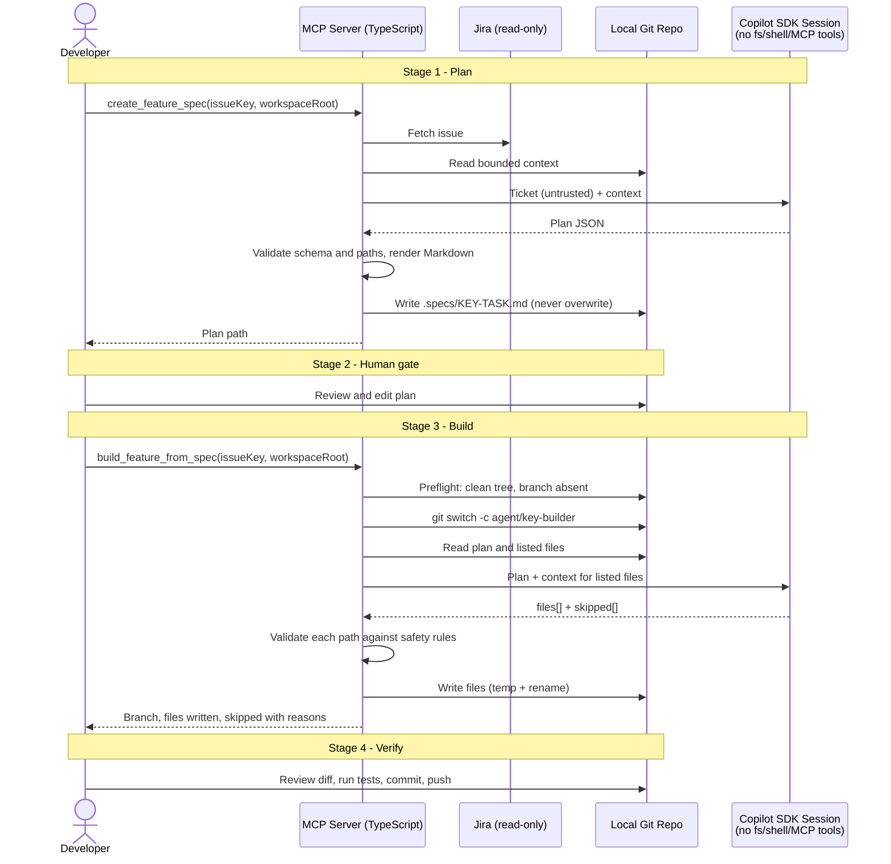

# Spec-First Feature Workflow: Architecture Overview

## 1. Purpose

Turn a Jira ticket into reviewed, scaffolded code with a human approval gate between planning and building. Two separate MCP tools implement the workflow. Neither runs automatically after the other.

| Stage      | Actor                             | Tool / Mechanism                | Output                                                  |
| ---------- | --------------------------------- | ------------------------------- | ------------------------------------------------------- |
| 1. Plan    | Human invokes, planner agent runs | `create_feature_spec`         | `.specs/{KEY}-TASK.md`                                |
| 2. Approve | Human                             | Manual review/edit of the plan  | Approved plan                                           |
| 3. Build   | Human invokes, builder agent runs | `build_feature_from_spec`     | Local branch `agent/{key}-builder` with files written |
| 4. Verify  | Human                             | Git diff, test run, code review | Merge decision                                          |

## 2. High-Level Flow



## 3. Sequence Detail



## 4. Component Responsibilities	

| Component                | File                                                    | Responsibility                                                                            |
| ------------------------ | ------------------------------------------------------- | ----------------------------------------------------------------------------------------- |
| Planner tool             | `src/tools/createFeatureSpec.ts`                      | Input validation, orchestration, timeouts, single-flight guard                            |
| Plan schema and renderer | `src/agents/featureSpec.ts`                           | Planner prompt, Zod plan schema, Markdown format (the contract the builder parses)        |
| Repo context             | `src/agents/repoContext.ts`                           | Bounded repo inspection (layout, stack, instruction files), no-overwrite save of the plan |
| Planner runner           | `src/agents/copilotFeatureSpec.ts`                    | Copilot session rooted at the repo with `view`/`grep`/`glob` only, 170s timeout     |
| Read policy              | `src/agents/readPolicy.ts`                            | Approves only in-repo reads of allowed file types                                         |
| Builder tool             | `src/tools/buildFeatureFromSpec.ts`                   | Git preflight, branch creation, orchestration                                             |
| Builder logic            | `src/agents/featureBuilder.ts`                        | Plan parsing, context, output validation, safe writes                                     |
| Builder runner           | `src/agents/copilotFeatureBuilder.ts`                 | Copilot session, no tools, 120s timeout                                                   |
| Failure codes            | `featureSpecFailure.ts`, `featureBuilderFailure.ts` | Sanitized error codes, no raw internals returned                                          |

## 5. Design Decisions

- **Human gates the build.** The builder is never triggered automatically. A person must read and approve the plan first.
- **The model proposes, the coordinator disposes.** The model has no filesystem, shell, Jira, or MCP access. It returns JSON, and TypeScript code validates and writes everything.
- **Scope is bounded by the plan.** The builder only touches paths listed in the plan's `**Files:**` lines. Anything it cannot ground in the repo context is reported in `skipped` instead of guessed.
- **Branch isolation is local only.** The builder creates `agent/{key}-builder`, refuses if it exists, and never pushes. Pushing and PRs stay with the human.
- **Clean worktree required.** The only allowed untracked file is the approved plan. This keeps the branch diff attributable to the builder.
- **Plan format is a contract.** The builder requires the `# Feature Plan: {KEY} - ` header, the `> Source ticket: {KEY}` line, and the `**Files:**` lines.

## 6. Security Controls

| Risk                                    | Control                                                                                                                                                                                       |
| --------------------------------------- | --------------------------------------------------------------------------------------------------------------------------------------------------------------------------------------------- |
| Prompt injection from Jira text         | Ticket content is treated as untrusted data. The model has no tools to act on it.                                                                                                             |
| Path traversal or sensitive file writes | Rejects absolute paths, `..`, backslashes, `.git`, `.specs`, `.env*`, agent instruction files (AGENTS.md, CLAUDE.md, .cursorrules, copilot-instructions.md), and key/cert extensions. |
| Symlink escapes                         | Symlinks are refused.                                                                                                                                                                         |
| Partial or corrupt files                | Writes go to a temp file and are then renamed. Existing file mode is preserved.                                                                                                               |
| Overwriting a plan                      | The save is link-based and never overwrites.                                                                                                                                                  |
| Runaway runs                            | Stage timeouts (90s and 120s), overall tool timeouts (180s and 360s), and a single-flight guard per tool.                                                                                     |
| Data leakage                            | Jira data goes to the model only where org policy allows. Errors are sanitized to codes.                                                                                                      |
| Unreviewed code reaching the remote     | Local branch only, no push.                                                                                                                                                                   |

## 7. Failure Handling

- Dirty worktree, existing branch, or a malformed plan: the tool refuses before calling the model.
- Invalid or unsafe model output: the affected files are rejected and reported.
- If a failure happens mid-write, files already written stay on the branch. The human inspects or deletes the branch.

## 8. Current Limitations

- The tools are unit tested (89 tests passing) and were exercised end to end against a mock Spring Boot repository with a real Copilot session (section 11). They have **not yet been run against live Jira or a real company repository**.
- The builder does not run tests or linters. Step 4 (review and test) is manual.
- It generates only plan-listed files. There is no patch-only mode.
- Output quality depends on the plan quality and the bounded repo context.

## 9. Possible Next Steps

- Run the project's test command after the build and include the result in the report.
- Add a patch-only (dry run) mode that returns a diff without writing.
- Optionally open a draft PR, still human-triggered.
- Test on a larger, real repository and on a multi-file feature or cross-layer bug.
- Semantic search with embeddings (vector database) is a possible later option. It is deliberately deferred: it requires sending the whole repo to an embedding model, keeping an index fresh, and a data-policy review. Revisit only if repositories are large, tickets share few words with the code, and the cheaper discovery steps in section 10 stop finding the right files.

## 10. Repository Discovery (how the planner finds the right files)

Jira descriptions are not template-driven and often say "relevant file: unknown". Discovery is done by the Copilot session itself, not by custom server-side ranking.

| Step        | What happens                                                                                                                                                                           | Model tokens used             |
| ----------- | -------------------------------------------------------------------------------------------------------------------------------------------------------------------------------------- | ----------------------------- |
| Layout      | The server sends a pruned directory tree (3 levels, max 120 entries), the detected stack, and repo instruction files (`.github/copilot-instructions.md`, `AGENTS.md`, and similar) | Yes (small)                   |
| Exploration | The planner session searches and reads files with `grep`, `glob` and `view`, then names the root cause and files                                                                 | Yes (only for files it opens) |

Reads pass `isReadAllowed` (see section 12). The earlier custom approach (term search, BM25F ranking, code map) was removed at the lead's direction; section 11 records how it performed.

**Builder fixes found during simulation**

- A directory (or other non-file) path in the plan is now reported in `skipped` instead of rejecting the whole plan.
- `**Files:** None specified` is accepted.
- Plan errors now name the offending path.
- The planner prompt requires file paths only, never directories.

---

## 11. Simulation

**Goal:** check the full workflow without Jira, using a real Copilot session against a mock project.

**Setup**

- **Mock repo:** `/home/georg/projects/mock-manager-ui`, a separate Git repo (the builder needs a clean repo root). It is a Spring Boot 3 MVC app with Thymeleaf, JUnit 5 and AssertJ, and layers `controller -> service -> repository`.
- **Traps built in:** the tab label lives in `ManagerTabService`, not the template. The old label is asserted in two tests. `admin.html` contains the same phrase in prose and must not change. `ReviewItemService` contains a real bug: the Ready tab filters on `status != DRAFT`.
- **Fixtures** (`simulation/fixtures/`): `SIM-101` is a structured label-rename ticket modeled on a real work ticket (names anonymized). `SIM-102` is a free-form bug report with no file hints.
- **Harness:** `src/example-simulate.ts` serves fixture text in place of Jira, then runs the real planner and builder.
- **Hints removed:** class names were taken out of the mock's instructions file, so file discovery had to work from the search and code map alone.

**How to run**

```bash
cd /home/georg/projects/jira-agents
npm run example:copilot-sdk                      # confirms the Copilot SDK is available
npm run simulate -- plan  SIM-101 /home/georg/projects/mock-manager-ui
# human reviews/edits mock-manager-ui/.specs/SIM-101-TASK.md
npm run simulate -- build SIM-101 /home/georg/projects/mock-manager-ui
cd ../mock-manager-ui && git diff main && mvn -q test
# reset before the next run
git checkout -- . && git switch main && git branch -D agent/sim-101-builder && rm -rf .specs
```

**Results** (first two rows used the removed custom search; explore mode results are in section 12)

| Ticket                     | First run                                                                                                                                                                                       | After improvements                                                                                                                                                                                                                                                                   |
| -------------------------- | ----------------------------------------------------------------------------------------------------------------------------------------------------------------------------------------------- | ------------------------------------------------------------------------------------------------------------------------------------------------------------------------------------------------------------------------------------------------------------------------------------ |
| SIM-101 label rename       | Plan found the right files, but only because the instructions file named them. The builder refused the plan because step 5 listed a directory (`PLAN_INVALID`); no model call, repo untouched | With hints removed, the plan found `ManagerTabService` and both tests from the quoted string alone and left `admin.html` out of scope with a reason. The builder changed only the 3 planned files; `mvn test` passed                                                           |
| SIM-102 bug, no file hints | Plan hedged ("diagnose first"), invented a "count" feature, and missed the buggy file                                                                                                           | Plan names the cause (`status != DRAFT` in `ReviewItemService.itemsForTab`) and the fix (`findByStatus`). The builder changed the service and its test; `mvn test` passed (9 tests). The new tests fail on the original code (2 failures), so they are real regression tests |

**What this showed**

- Structured tickets and symptom-only bug reports both produced usable plans once file discovery was server-side.
- The builder read the full files and was more precise than the planner, and reported unchanged files under `skipped` with reasons.
- The planner still sometimes invents details (test names, a "count" feature). The human review of the plan and of the diff remains necessary.

**Not covered:** a large real repository, a multi-file feature, a bug that spans layers, non-Java stacks end to end, and live Jira.

## 12. Explore Mode (Copilot searches the repo itself)

The lead prefers model-side search over our own ranking, so explore mode is now the planner's only mode.

- The Copilot session is rooted at the repository (`workingDirectory`) and gets only the built-in tools `view`, `grep` and `glob`. Shell, edit, create, web and sub-agent tools are not offered.
- A permission handler approves a read only when `isReadAllowed` (`src/agents/readPolicy.ts`) accepts the path; everything else is rejected with feedback to the model.
- The policy keeps reads inside the repository (symlinks resolved), blocks hidden paths such as `.git` and `.env`, build and dependency folders, lock files, minified files, and any extension outside a source/config/docs allowlist. This also limits tokens.
- Reads are also bounded: files over 200 KB, generated artifacts (SVG, source maps, Swagger/OpenAPI JSON, coverage reports, localization bundles) are refused, and `ReadBudget` caps a session at 40 reads and 600 KB. A rejected read returns feedback to the model; nothing is raised as an error.
- Clarification is model-driven, not automatic: when a ticket is too vague or the budget is exhausted, the instructions tell the model to stop and put `NEEDS CLARIFICATION:` entries first in `openQuestions`. `createFeatureSpec.ts` then detects those entries, returns `needsClarification: true` with the questions, and does not save the plan (an existing plan is never overwritten, so saving would block the rerun).
- `EXPLORE_DEBUG=1` logs each read decision when running the harness.

**Results (mock Spring Boot repo, real Copilot sessions)**

| Ticket                     | Reads   | Time       | Result                                                                                                                |
| -------------------------- | ------- | ---------- | --------------------------------------------------------------------------------------------------------------------- |
| SIM-102 (symptom-only bug) | 5 to 10 | about 15 s | Opened `ReviewItemService`, named the `!= DRAFT` root cause and the correct fix (4 of 4 runs after the fix below) |
| SIM-101 (label rename)     | 3       | about 13 s | Correct service and test files, `admin.html` decoy left out of scope                                                |
| SIM-103 (vague: "input selection missing in a drop-down on the admin page") | about 5 | n/a | Flagged `NEEDS CLARIFICATION` (2 questions), nothing saved. It found that `admin.html` has no drop-down and asked which field and options were meant |
| SIM-102 after read limits | 5 | n/a | Plan saved normally, 0 reads denied |

**Issues found**

- With no tool restriction the model tried a shell command, which was denied and failed the session. The tool list is now limited to the three read tools.
- One run passed a quoted path to a search tool, which was denied, and the model returned malformed output. The policy now strips wrapping quotes, and denials carry feedback. Four consecutive runs afterward succeeded.
- Still possible: the model occasionally returns output that does not match the plan format; the server reports `MODEL_OUTPUT_INVALID` and the run can be repeated.

Not yet measured: large repositories, token cost, and the builder stage (unchanged; it still writes only the files in the approved plan).

---

## 13. Files to Transfer

This list covers only what changed after the first transfer (the planner and builder tools and their original tests were already copied). Everything is untracked in Git, so copy by path. Paths are relative to `/home/georg/projects/jira-agents/`.

**New files**

| File                                | Purpose                             |
| ----------------------------------- | ----------------------------------- |
| `src/agents/readPolicy.ts`        | Read policy for the planner session |
| `src/agents/readPolicy.test.ts`   | Tests for the read policy           |
| `src/example-simulate.ts`         | Simulation harness                  |
| `simulation/fixtures/SIM-101.txt` | Mock ticket: label rename           |
| `simulation/fixtures/SIM-102.txt` | Mock ticket: bug report             |
| `feature-workflow.md`             | This document                       |

**Existing files that changed**

| File                                    | Change                                                                                                        |
| --------------------------------------- | ------------------------------------------------------------------------------------------------------------- |
| `src/agents/featureSpec.ts`           | Planner prompt: file paths only, explore-the-repo instructions; model gets the workspace root                 |
| `src/agents/featureBuilder.ts`        | Skips directories and `None specified` lines, reports them in `skipped`, names the failing path in errors |
| `src/agents/copilotFeatureSpec.ts`    | Replaced: repo-rooted session with `view`/`grep`/`glob` and the read policy                             |
| `src/agents/featureBuilderFailure.ts` | Failure errors can carry a detail message                                                                     |
| `src/agents/featureBuilder.test.ts`   | New test for the directory and `None specified` cases                                                       |
| `src/tools/createFeatureSpec.ts`      | Planner model now explores the repo                                                                           |
| `package.json`                        | `test` script adds `readPolicy.test.ts`; added the `simulate` script                                    |
| `readme.md`                           | Describes read-only repo exploration                                                                          |

`repoContext.ts` is back to its original form, so no copy is needed. If you copied any `repoSearch`, `repoRank` or `repoMap` files from an earlier version of this document, delete them. Unchanged this session: `quick-reference.md`, `src/agents/repoContext.test.ts`, `src/tools/index.ts`, `src/jira/triage.ts` and the other tool and test files.

**Mock project `mock-manager-ui/` (optional, only for repeating the simulation)**
Copy the whole folder, including its `.git` directory, which holds the baseline commits. It contains `pom.xml`, `.gitignore`, `.github/copilot-instructions.md`, and the Java sources, templates and tests under `src/`. It currently has uncommitted builder output and a `.specs/` folder. Reset it as shown in section 11 first.

**After copying:** run `npm install`, then `npm run typecheck` and `npm test` (83 tests). The mock project needs Java 17 and Maven. Confirm Copilot access with `npm run example:copilot-sdk`.
